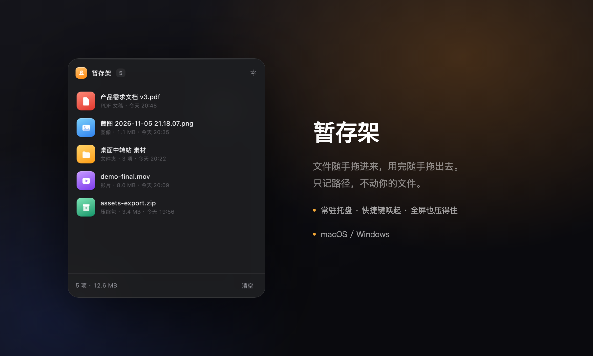

# 暂存架 · File Shelf

[](https://github.com/wuteng606/file-shelf/actions/workflows/release.yml)
[](https://github.com/wuteng606/file-shelf/actions/workflows/ci.yml)
[](./LICENSE)

一个桌面文件暂存架，支持 **macOS / Windows**（应用名 `FileShelf`，界面里叫「暂存架」）。文件拖进来暂存，用完拖出去，只记录路径、不动磁盘上的文件。常驻托盘、快捷键唤起、全屏也压得住。



## 功能

- **拖入即存**：文件、文件夹、一次拖多个都行，重复路径自动跳过
- **拖出即用**：从列表按住拖出去，直接丢进访达 / 资源管理器、微信、邮件、网页上传框，和从桌面拖文件完全一样
- **只记路径**：不复制、不移动、不删除。再大的视频也是秒进，磁盘上一点没变
- **清空只清列表**：清空 ≠ 删文件，原文件该在哪还在哪
- **全屏也压得住**：别的应用进了全屏，面板依然浮在最上层，切桌面也跟着走
- **跟随托盘**：面板固定贴在托盘图标旁（macOS 在下方、Windows 在上方），多显示器按图标所在屏幕算
- **后台运行**：macOS 是 `LSUIElement`，只留菜单栏图标，不占 Dock、不进 `⌘ Tab`；Windows 用 `skipTaskbar`，不占任务栏
- **快捷键可改**：默认 macOS `⌥ ⌘ Space`、Windows `Ctrl Alt Space`，设置里点一下就能录新的
- **开机自启**：登录后静默启动，不弹面板
- **深浅色**：跟随系统 / 强制深色 / 强制浅色，毛玻璃效果同步切换
- **失效提示**：原文件被移走或删除，列表里会标灰，不会点了没反应
- **单实例**：重复打开只会把已有面板叫出来，不会出现第二个托盘图标

轻量：安装包 macOS 2.3 MB / 应用本体 3.9 MB，不联网、不弹窗、无账号。

## 快捷键

| 操作 | 快捷键 |
| --- | --- |
| 唤起 / 收起面板（全局） | `⌥ ⌘ Space`（Windows 为 `Ctrl Alt Space`） |
| 在访达 / 资源管理器中显示 | 悬停行尾的箭头按钮 |
| 打开文件 | 双击行 |
| 移除单项 | 悬停行尾的减号按钮 |
| 清空列表 | 底部「清空」 |
| 收起面板 | `Esc` |
| 设置 | 右上角齿轮 |

快捷键可以在设置里重录，录制期间旧的全局热键会临时注销，避免按到旧组合把面板收起。

## 安装

**Windows**：到 [Releases](https://github.com/wuteng606/file-shelf/releases) 下载 `FileShelf_*_x64-setup.exe`，双击安装。

**macOS**：下载 `FileShelf_*_universal.dmg`（Apple Silicon / Intel 通用），打开后把 `FileShelf.app` 拖进「应用程序」。

> 安装包未签名公证：
> - Windows SmartScreen 提示「未知发布者」→「更多信息」→「仍要运行」。
> - macOS 首次打开被拦下 → 右键 App →「打开」，或 `xattr -dr com.apple.quarantine "/Applications/FileShelf.app"`。

## 开发

```bash
npm install
npm run app:dev      # Vite 热更新 + Rust 调试构建
npm run app:build    # 打包当前平台
```

产物按平台自动选择：

```
macOS:   src-tauri/target/release/bundle/macos/FileShelf.app  +  dmg/FileShelf_*.dmg
Windows: src-tauri/target/release/bundle/nsis/*.exe  +  msi/*.msi
```

> Windows 版需要在 Windows 机器上构建，Tauri 不支持从 macOS 交叉编译过去。
> 首次需装 Rust toolchain + VS Build Tools（C++ 桌面开发）。
>
> 生成 dmg 需要 `hdiutil` 权限，在受限终端里可能失败（`hdiutil: create failed - 操作不被允许`），换普通终端执行即可。

## 发布新版本

仓库带了两条 GitHub Actions 工作流：

- `.github/workflows/ci.yml`：push 到 `main` / PR 时跑前端构建，并在 **Windows** 上 `cargo check`（提前发现只在 Windows 才会暴露的编译问题）
- `.github/workflows/release.yml`：打 `v*` tag 时并行构建 **Windows NSIS 安装包** 和 **macOS 通用包（Apple Silicon + Intel）**，自动挂到 Release

```bash
# 1. 改版本号：package.json、src-tauri/tauri.conf.json、src-tauri/Cargo.toml 保持一致
# 2. 提交后打 tag，工作流自动构建并发布
git commit -am "chore: bump to v0.1.1"
git tag v0.1.1
git push origin main --tags
```

也可以在 GitHub 的 **Actions → Release → Run workflow** 手动触发。想同时产出 MSI，把工作流里的 `--bundles nsis` 改成 `--bundles nsis,msi`。

> 私有仓库的 Actions 有免费额度：Windows 按 2 倍、macOS 按 10 倍计分钟。一次双平台 release 大约消耗 200 分钟额度，调试时建议用 `workflow_dispatch` 而不是反复打 tag。

## 技术栈

Tauri 2 · Rust 1.89 · 原生 TypeScript（Vite，无框架）· `tauri-plugin-drag` / `global-shortcut` / `autostart` / `single-instance` · `window-vibrancy`

> **macOS 的全屏置顶**是这套代码里最绕的一段：普通 `NSWindow` 无论怎么调 `level` 和 `collectionBehavior`，
> 都进不了别的应用的全屏 Space。运行时把窗口改造成「非激活 NSPanel」（`src-tauri/src/macos_overlay.rs`）才行——
> 这也是 Spotlight / Raycast 那一类面板的做法：`NonactivatingPanel` + `CanJoinAllSpaces | FullScreenAuxiliary`，
> 层级抬到 `NSPopUpMenuWindowLevel`。另外显示时绝不能调 `set_focus()`，它会激活 App、把当前全屏 Space 顶掉。
>
> 托盘图标用的是 macOS **模板图**（纯黑 + alpha），系统按菜单栏明暗自动反色，和系统图标同一套视觉语言。
> 应用本身是 `ActivationPolicy::Accessory` + 打包时 `Info.plist` 的 `LSUIElement`：后台运行、无 Dock 图标。

## 目录

```
src/              前端（原生 TS）
  main.ts         列表渲染、拖入拖出、设置面板
  styles.css      面板样式与深浅色
index.html        面板结构
preview/          UI 稿与截图
promo/            小红书推广图与文案
.assets/          图标源文件（SVG + 渲染好的 PNG）
src-tauri/        Rust：窗口 / 托盘 / 快捷键 / 持久化
  src/lib.rs      命令、状态、托盘、定位
  src/macos_overlay.rs  NSPanel 改造
.github/          CI / Release 工作流
```

## 数据位置

```
macOS:   ~/Library/Application Support/cn.wuteng.fileshelf/state.json
Windows: %APPDATA%\cn.wuteng.fileshelf\state.json
```

一个 JSON，存暂存项和设置，没有数据库、不上传。

## License

[MIT](./LICENSE)
